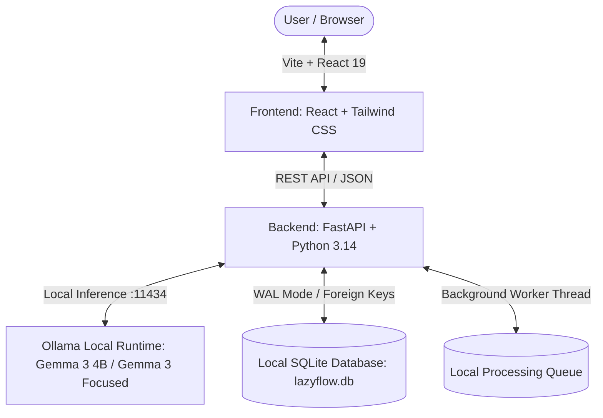

# 🦥 LazyFlow AI — Your Local AI Productivity Agent

> **Take it slow. Let local AI flow.**  
> A privacy-first, on-device AI productivity agent built for the **Hacktoberfest Open-Source AI Challenge: “Slow and Steady”**.

---


## 🌟 The "Slow and Steady" Vision
In today's fast-paced work environment, knowledge workers spend hours drowning in long meeting transcripts, dense technical postmortems, vendor contracts, and messy folder hierarchies. 

Cloud AI tools come with severe trade-offs: data privacy risks, expensive per-token fees, API rate limits, and network latency. **LazyFlow AI** embraces the Hacktoberfest **“Slow and Steady”** ethos:
- **100% Local Inference:** Powered by open-weight AI models (e.g., Google Gemma 3 4B, Meta Llama 3.2, Mistral) via **Ollama**.
- **Zero Cloud Leakage:** Documents, summaries, and action plans are never uploaded to third-party servers. All data resides safely in your local **SQLite** database.
- **Mental Clarity:** Automatically generates crisp executive summaries, extracts structured high-priority deliverables with assignees & due dates, suggests intelligent folder paths, and compiles daily digests.

---

## 🚀 Key Features

| Feature | Description |
| :--- | :--- |
| **📄 Multi-Format Ingestion** | Drag-and-drop parsing for Markdown (`.md`), Plain Text (`.txt`), Adobe PDF (`.pdf`), Word Documents (`.docx`), JSON, and CSV. |
| **⚡ Real Local AI Summarization** | Real local inference via Ollama (no mock responses). Synthesizes 2-3 paragraph executive overviews with bullet takeaways. |
| **🔍 Source Evidence** | Every extracted task is anchored to supporting excerpt quotes directly from the source document for complete transparency. |
| **⏰ Deadline Intelligence** | Distinguishes explicit calendar dates (`YYYY-MM-DD`) from AI-inferred fuzzy timelines (`in 2 weeks`, `next sprint`), with overdue and days-remaining counters. |
| **🧩 Smart Task Deduplication** | Detects duplicate or correlated deliverables across multiple documents and offers 1-click merging while preserving provenance. |
| **🛡️ Safe Automation Preview** | Proactive file organization and standardized file renames with safe user preview. Zero filesystem operations without explicit user approval. |
| **🌅 One-Click Daily Flow** | Unified daily workspace aggregating today's top priorities, overdue deliverables, cross-document risks, and sloth productivity tips. |
| **☕ Smart Daily Briefing** | **[Phase 3]** Generates a prioritized morning briefing with urgent actions, upcoming deadlines, cross-document risks, and recommended next steps, all grounded in source data. |
| **📈 AI Productivity Insights** | **[Phase 3]** Dashboard displaying pending vs completed tasks, overdue items, processing success rate, and grounded manual effort saved with full formula transparency. |
| **🔄 Background Processing Queue** | **[Phase 3]** Local queue for batch document processing with progress bars, retry, safe cancellation, and restart crash recovery. |
| **⚖️ Local Model Comparison** | **[Phase 3]** Side-by-side practical comparison of two installed Ollama models evaluating latency, output completeness, and schema validity. |
| **🔒 Privacy & Offline Verification** | **[Phase 3]** Live privacy audit panel verifying loopback binding, local SQLite persistence, zero external telemetry, and offline readiness. |
| **🎬 Guided Demo Mode** | **[Phase 3]** Interactive 6-stage walkthrough utilizing real application functionality to demo ingestion, evidence extraction, deduplication, deadlines, workflow, and safe automation. |
| **🎯 1-Click Judge Demos** | Built-in sample test bench (Roadmap Meeting, P1 Outage Postmortem, Enterprise SLA Contract, UX Research) for instant 5-second evaluation. |
| **🎨 Modern SaaS UI** | Built with React, TypeScript, Vite, and Tailwind CSS. Features dark/light mode, real-time pipeline status modals, and responsive layout. |

---

## 🛠️ Architecture & Tech Stack



- **Frontend:** React 19, TypeScript, Vite, Tailwind CSS v4, Lucide React Icons.
- **Backend:** Python 3.14, FastAPI, Uvicorn, Pydantic v2, SQLite3 with WAL mode.
- **Document Extractors:** `pypdf`, `python-docx`, UTF-8 stream parsers.
- **Local AI Engine:** Ollama HTTP REST API (`http://localhost:11434`) running lightweight open-weight models (`gemma3:4b`, `gemma3:focused`, etc.).

---

## 💻 Exact Windows Setup & Run Guide

### Prerequisites
1. **Python 3.10+** (Tested on Python 3.14)
2. **Node.js 18+ & npm** (Tested on Node v24)
3. **Ollama** installed on Windows ([Download Ollama](https://ollama.com/download))

### Step 1: Start Ollama & Verify Installed Models
Open PowerShell:
```powershell
# Verify Ollama is running
ollama list

# Pull a lightweight open-weight model (Gemma 3 4B recommended)
ollama pull gemma3:4b
```

---

### Step 2: Start the FastAPI Backend
Open a new PowerShell terminal:
```powershell
cd c:\OpenSource\LazyFlow-AI\backend

# Install backend dependencies
python -m pip install -r requirements.txt

# Run backend server
python run_backend.py
```
- Backend starts at: `http://127.0.0.1:8000`
- Interactive Swagger API Documentation: `http://127.0.0.1:8000/docs`

---

### Step 3: Start the React Frontend
Open another PowerShell terminal:
```powershell
cd c:\OpenSource\LazyFlow-AI\frontend

# Install frontend dependencies
npm install

# Start Vite dev server
npm run dev
```
- Open `http://localhost:5173/` in your browser!

---

### Step 4: Run the Automated Unit Test Suite
To run the automated backend test suite (covering smart deduplication, deadline intelligence, queue recovery, metrics calculation, model comparisons, and offline privacy verification):
```powershell
cd c:\OpenSource\LazyFlow-AI\backend
python -m pytest tests -v
```
*(23 automated unit tests pass in ~0.5s)*

---

## 📡 REST API Reference

| Method | Endpoint | Description |
| :--- | :--- | :--- |
| `GET` | `/api/health` | System health, Ollama status, model count, and database stats. |
| `GET` | `/api/models` | List all installed Ollama models and current active model. |
| `POST` | `/api/settings/model` | Switch the active Ollama model. |
| `GET` | `/api/samples` | List preloaded Hacktoberfest demo documents. |
| `POST` | `/api/documents/sample/{id}` | Ingest and process a sample document with local AI. |
| `POST` | `/api/documents/upload` | Multipart file upload (`.md`, `.txt`, `.pdf`, `.docx`, `.json`, `.csv`). |
| `POST` | `/api/documents/paste` | Direct text paste processing. |
| `GET` | `/api/documents` | List all processed documents with task counts. |
| `GET` | `/api/documents/{id}` | Full document summary, raw content, and action items. |
| `POST` | `/api/documents/{id}/reprocess` | Re-run AI analysis with current or selected model. |
| `DELETE` | `/api/documents/{id}` | Delete document and cascade delete associated tasks. |
| `GET` | `/api/action-items` | Filter action items by completion status, priority, and deadline status. |
| `PATCH` | `/api/action-items/{id}` | Update task title, priority, assignee, due date, or completed status. |
| `POST` | `/api/action-items` | Create a custom action item with source quotes and deadlines. |
| `DELETE` | `/api/action-items/{id}` | Delete an action item. |
| `GET` | `/api/action-items/duplicates` | **[Phase 2]** Scan for duplicate or overlapping action items across documents. |
| `POST` | `/api/action-items/merge` | **[Phase 2]** Merge duplicate tasks into a consolidated task with source citations. |
| `GET` | `/api/automation/proposals` | **[Phase 2]** Fetch pending file movement and rename proposals. |
| `POST` | `/api/automation/apply` | **[Phase 2]** Execute approved safe file rename and move operations. |
| `POST` | `/api/automation/reject` | **[Phase 2]** Dismiss rejected automation proposals. |
| `GET` | `/api/workflow/daily` | **[Phase 2]** Unified daily workspace: priorities, overdue tasks, risks, and tips. |
| `GET` | `/api/briefing/today` | **[Phase 3]** Synthesizes prioritized morning briefing with grounded citations. |
| `POST` | `/api/briefing/generate` | **[Phase 3]** Force generates fresh Smart Daily Briefing. |
| `GET` | `/api/insights` | **[Phase 3]** Returns verified productivity metrics and grounded effort saved calculations. |
| `GET` | `/api/queue` | **[Phase 3]** Lists items in the background processing queue. |
| `POST` | `/api/queue/batch-samples` | **[Phase 3]** Batch enqueues multiple sample documents for processing. |
| `POST` | `/api/queue/enqueue` | **[Phase 3]** Enqueues custom document for reliable queue execution. |
| `POST` | `/api/queue/{id}/retry` | **[Phase 3]** Retries failed, interrupted, or cancelled queue items. |
| `POST` | `/api/queue/{id}/cancel` | **[Phase 3]** Safely cancels queued or in-progress document processing. |
| `POST` | `/api/models/compare` | **[Phase 3]** Runs side-by-side evaluation between two installed Ollama models. |
| `GET` | `/api/models/comparisons` | **[Phase 3]** Retrieves history of past model comparisons. |
| `GET` | `/api/privacy/status` | **[Phase 3]** Inspects local loopback binding and on-device storage. |
| `POST` | `/api/privacy/verify-offline` | **[Phase 3]** Runs live audit verifying zero WAN telemetry and air-gap readiness. |

---

## 🔒 Security & Privacy Guarantee

- **No Remote Telemetry:** LazyFlow AI operates entirely offline.
- **Air-Gapped Operation:** All natural language processing executes within the Ollama runtime on `localhost:11434`.
- **Zero API Keys:** No OpenAI, Anthropic, or external API keys required.

---

## 📄 License
This project is licensed under the [MIT License](LICENSE). Built with ❤️ for the Hacktoberfest Open-Source AI Challenge.
