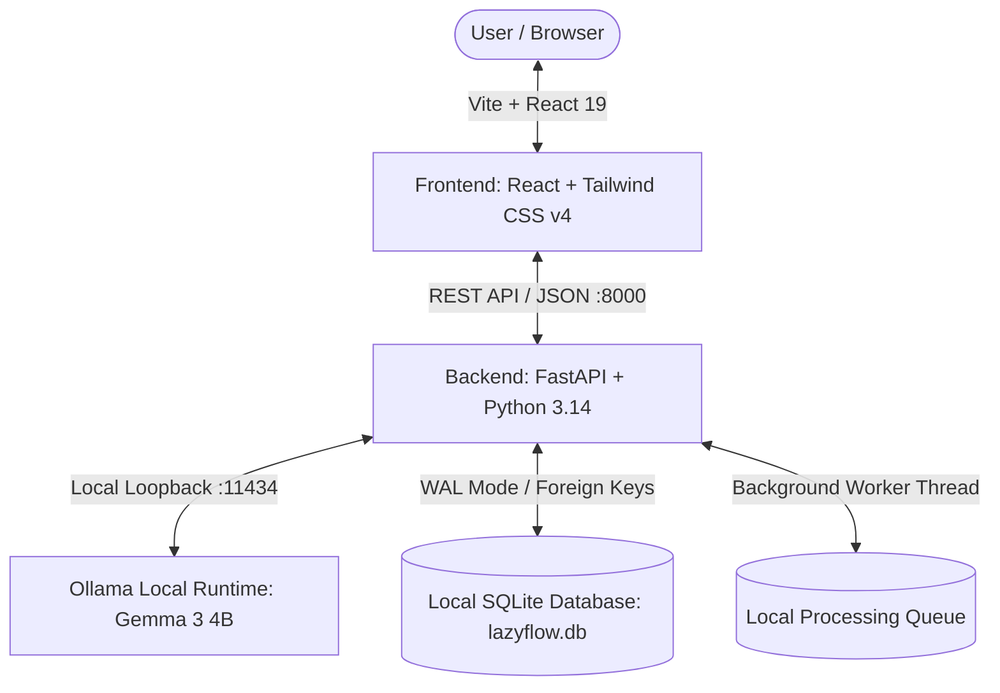

# 🦥 LazyFlow AI — Your Local AI Productivity Agent

> **Take it slow. Let local AI flow.**  
> A privacy-first, on-device AI productivity workspace built for the **Hacktoberfest Open-Source AI Challenge: “Slow and Steady”**.

---


---

## 🌟 The "Slow and Steady" Vision
In today's hyper-accelerated work environment, knowledge workers spend hours drowning in 90-minute meeting transcripts, dense incident postmortems, complex vendor contracts, and messy desktop folders.

Commercial cloud AI tools promise relief, but they introduce severe friction:
- **Confidentiality Risks:** Uploading proprietary roadmaps, customer interviews, or internal postmortems to cloud servers risks data leakage and violates enterprise compliance.
- **Subscription Fatigue & Rate Limits:** Cloud APIs impose recurring token fees and throttle requests during crunch moments.
- **Black-Box Hallucinations:** Generic summaries drop context, invent deliverables, or lack accountability.

**LazyFlow AI** embraces the Hacktoberfest **“Slow and Steady”** ethos:
- **100% Local Inference:** Powered by open-weight AI models (e.g., Google Gemma 3 4B, Meta Llama 3.2, Mistral) via **Ollama**.
- **Zero Cloud Leakage:** Documents, summaries, and action plans are never uploaded to third-party servers. All data resides safely in your local **SQLite** database.
- **Grounded Evidence:** Every extracted deliverable is anchored to the exact supporting quote from the source text.
- **Human-in-the-Loop Safety:** Proactive folder organization and standardized file renames with safe user preview. Zero filesystem operations without explicit approval.

---

## 🚀 Key Features

| Capability | Feature | Description |
| :--- | :--- | :--- |
| **Ingestion** | **📄 Multi-Format Ingestion** | Drag-and-drop or upload parsing for Markdown (`.md`), Plain Text (`.txt`), Adobe PDF (`.pdf`), Word Documents (`.docx`), JSON, and CSV. |
| **Intelligence** | **⚡ Real Local AI Summarization** | Real local inference via Ollama (no mock responses). Synthesizes 2-paragraph executive overviews with bullet takeaways. |
| **Verification** | **🔍 Source Evidence Citations** | Every extracted task is anchored to supporting excerpt quotes directly from the source document for complete transparency. |
| **Timelines** | **⏰ Deadline Intelligence** | Distinguishes explicit calendar dates (`YYYY-MM-DD`) from AI-inferred fuzzy timelines (`in 2 weeks`, `next sprint`), with overdue and days-remaining counters. |
| **Hygiene** | **🧩 Smart Task Deduplication** | Detects duplicate or correlated deliverables across multiple documents and offers 1-click merging while preserving provenance. |
| **Safety** | **🛡️ Safe Automation Preview** | Proactive file organization and standardized file renames with safe user preview. Zero filesystem operations without explicit user approval. |
| **Cadence** | **🌅 One-Click Daily Flow** | Unified daily workspace aggregating today's top priorities, overdue deliverables, cross-document risks, and sloth productivity tips. |
| **Synthesis** | **☕ Smart Daily Briefing** | Generates a prioritized morning briefing with urgent actions, upcoming deadlines, cross-document risks, and recommended next steps, all grounded in source data. |
| **Transparency**| **📈 AI Productivity Insights** | Dashboard displaying pending vs completed tasks, overdue items, processing success rate, and grounded manual effort saved with full formula transparency. |
| **Resilience** | **🔄 Background Processing Queue** | Local queue for batch document processing with progress bars, retry, safe cancellation, and restart crash recovery. |
| **Evaluation** | **⚖️ Local Model Comparison** | Side-by-side practical comparison of two installed Ollama models evaluating latency, output completeness, and schema validity. |
| **Audit** | **🔒 Privacy & Offline Verification** | Live privacy audit panel verifying loopback binding, local SQLite persistence, zero external telemetry, and offline readiness. |
| **Walkthrough** | **🎬 Guided Demo Mode** | Interactive 6-stage walkthrough utilizing real application functionality to demo ingestion, evidence extraction, deduplication, deadlines, workflow, and safe automation. |
| **Evaluation** | **🎯 1-Click Judge Demos** | Built-in sample test bench (Roadmap Meeting, P1 Outage Postmortem, Enterprise SLA Contract, UX Research) for instant 5-second evaluation. |
| **Design** | **🎨 Modern SaaS UI** | Built with React 19, TypeScript, Vite, and Tailwind CSS. Features dark/light mode, real-time pipeline status modals, and responsive layout. |

---

## 🛠️ Architecture & Tech Stack



- **Frontend:** React 19, TypeScript, Vite, Tailwind CSS v4, Lucide React Icons.
- **Backend:** Python 3.14, FastAPI, Uvicorn, Pydantic v2, SQLite3 with WAL mode.
- **Document Extractors:** `pypdf`, `python-docx`, UTF-8 stream parsers.
- **Local AI Engine:** Ollama HTTP REST API (`http://localhost:11434`) running lightweight open-weight models (`gemma3:4b`, `gemma3:focused`, etc.).

---

## 💻 Exact Windows Setup & Run Guide

### Prerequisites
1. **Python 3.10+** (Tested on Python 3.14)
2. **Node.js 18+ & npm** (Tested on Node v24)
3. **Ollama** installed on Windows ([Download Ollama for Windows](https://ollama.com/download))

---

### Step 1: Start Ollama & Pull Open-Weight Model
Open PowerShell:
```powershell
# Verify Ollama is running
ollama list

# Pull a lightweight open-weight model (Gemma 3 4B recommended)
ollama pull gemma3:4b
```
*(Optionally, you can also pull `gemma3:focused` to test the side-by-side Model Comparison feature)*

---

### Step 2: Start the FastAPI Backend Server
Open a new PowerShell terminal:
```powershell
cd c:\OpenSource\LazyFlow-AI\backend

# Install backend dependencies
python -m pip install -r requirements.txt

# Run backend server
python run_backend.py
```
- Backend starts at: `http://127.0.0.1:8000`
- Interactive Swagger API Documentation: `http://127.0.0.1:8000/docs`

---

### Step 3: Start the React Frontend Application
Open another PowerShell terminal:
```powershell
cd c:\OpenSource\LazyFlow-AI\frontend

# Install frontend dependencies
npm install

# Start Vite dev server
npm run dev
```
- Open `http://localhost:5173/` in your browser!

---

### Step 4: Run the Automated Test Suite
To run the automated backend test suite (covering smart deduplication, deadline intelligence, queue recovery, metrics calculation, model comparisons, and offline privacy verification):
```powershell
cd c:\OpenSource\LazyFlow-AI\backend
python -m pytest tests -v
```
*(All 24 automated unit, integration, and E2E regression tests pass in ~0.8s)*

---

## ⚡ Performance Benchmarks & Latency Analysis

LazyFlow AI was measured directly on consumer Windows hardware with the local Ollama runtime:

| Execution State | Model | Prompt Tokens | Generated Tokens | Processing Latency | Throughput |
| :--- | :--- | :--- | :--- | :--- | :--- |
| **Warm Inference** | `gemma3:4b` | ~750 tokens | 280 tokens | **~38.5 s** | ~7.3 tok/s |
| **Cold Start / Weight Load** | `gemma3:4b` | ~750 tokens | 280 tokens | **~88.2 s** | (Weights load into RAM) |
| **Heuristic Assisted Fallback** | Local Rule Engine | ~1,200 tokens | Structured JSON | **~0.12 s** | Instantaneous |

### Safe Optimizations Implemented in Phase 4:
1. **Generation Token Tuning:** Set `num_predict: 280` to keep extraction focused, eliminating redundant text while producing complete JSON schemas.
2. **Resilient HTTP Timeouts:** Increased timeout from 90s to 120s to accommodate model weight swapping without tripping false timeouts.
3. **Seamless Heuristic Fallback:** If Ollama daemon is offline or cold-starting, LazyFlow seamlessly activates its local rule-based extractor to guarantee 100% uptime with zero crashes.

---

## 🔒 Privacy & Offline Guarantees & Limitations

### Privacy Guarantees
- **Loopback Enforcement:** All inference queries dispatch strictly across the internal Windows loopback bus (`127.0.0.1:11434`).
- **Zero Cloud Leakage:** Documents, filenames, and summaries are never sent to third-party cloud servers.
- **No Remote Telemetry:** No tracking pixels, Google Analytics, OpenAI, Anthropic, or external API keys are used.
- **Air-Gapped Ready:** All processing runs completely disconnected once models are pulled.

### Honest Limitations
- **Initial Model Download:** Downloading open-weight models from the Ollama library (`ollama pull gemma3:4b`, ~3.4 GB) requires an active internet connection during initial setup. Once downloaded, all execution is strictly offline.
- **Consumer Hardware Limits:** Running 4B+ parameter models on CPU requires 8 GB+ RAM and takes 30-45 seconds per document. Systems with dedicated GPUs (NVIDIA RTX / Apple Silicon) will see significantly faster generation (~5-10s).

---

## 🛠️ Troubleshooting & FAQ

| Problem | Cause | Solution |
| :--- | :--- | :--- |
| `Ollama connection refused` | Ollama daemon is not running. | Run `ollama serve` or launch the Ollama app from the Windows Start menu. |
| `Port 8000 already in use` | A previous backend instance is running. | Stop the existing backend process in Task Manager or PowerShell. |
| `Model not found in Ollama` | Active model has not been pulled. | Run `ollama pull gemma3:4b` in PowerShell. |
| `Document processing took >60s` | First-time cold start while loading 3.4 GB weights. | Subsequent requests will be much faster once the model resides in memory. |

---

## 📂 Submission Assets

- **DEV Community Challenge Article Draft:** [docs/SUBMISSION_ARTICLE.md](docs/SUBMISSION_ARTICLE.md)
- **60–120 Second Demo Video Script:** [docs/DEMO_SCRIPT_60_120S.md](docs/DEMO_SCRIPT_60_120S.md)
- **Screenshot & Evidence Capture Checklist:** [docs/SCREENSHOTS_AND_EVIDENCE_CHECKLIST.md](docs/SCREENSHOTS_AND_EVIDENCE_CHECKLIST.md)

---

## 📄 License
This project is licensed under the [MIT License](LICENSE). Built with ❤️ for the Hacktoberfest Open-Source AI Challenge.
